<h1 align="center">Habbit Strick</h1>

<p align="center">
  <b>A private, science-based habit tracker for Android, Windows and the web.</b><br>
  Build good habits, quit bad ones, and keep your phone from taking over your day.
</p>

<p align="center">
  <a href="https://github.com/mrs1ddharthyadav/habbitstrick/releases/download/latest/Habbit-Strick.apk"><b>Download for Android</b></a>
  &nbsp;|&nbsp;
  <a href="https://github.com/mrs1ddharthyadav/habbitstrick/releases/download/latest/Habbit-Strick-Setup.exe"><b>Download for Windows</b></a>
  &nbsp;|&nbsp;
  <a href="https://github.com/mrs1ddharthyadav/habbitstrick/releases/tag/latest">All releases</a>
</p>

<p align="center">
  <a href="https://github.com/mrs1ddharthyadav/habbitstrick/actions/workflows/build.yml"></a>
  
  
  
</p>

<p align="center">
  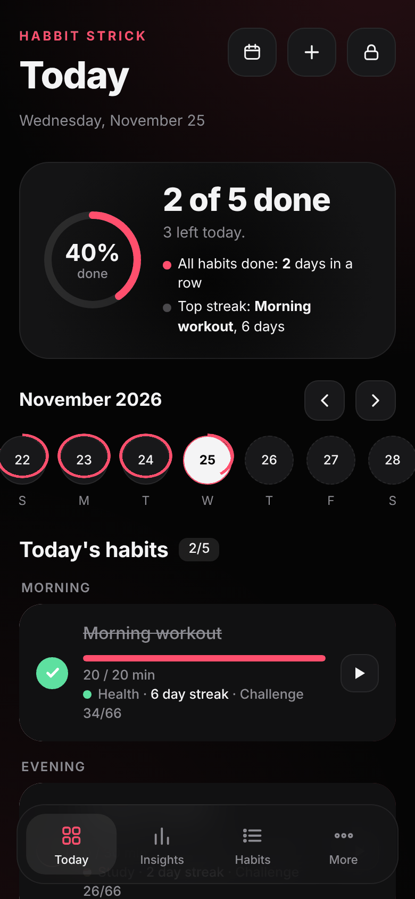
  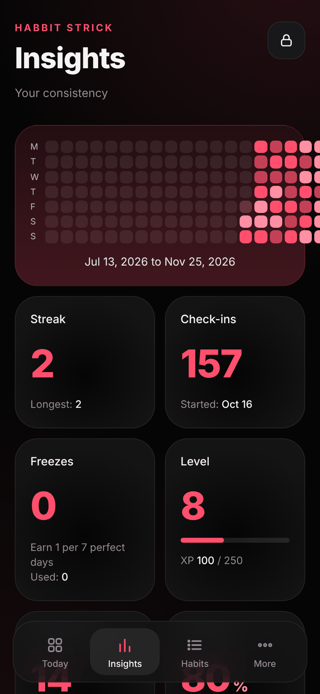
  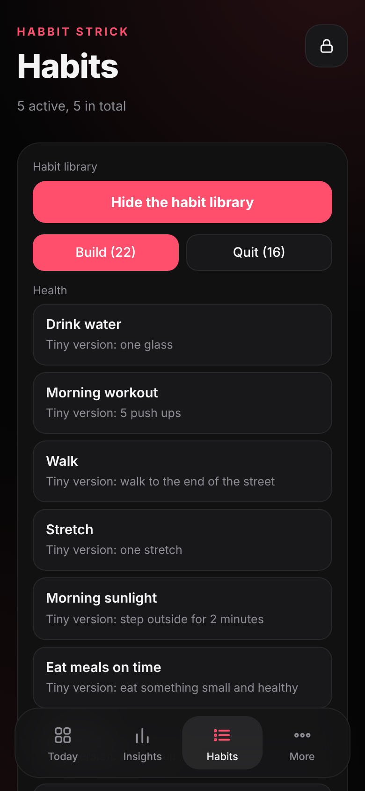
</p>

---

## Contents

- [Why Habbit Strick](#why-habbit-strick)
- [Features](#features)
- [Themes](#themes)
- [The science behind it](#the-science-behind-it)
- [Install](#install)
- [Privacy and security](#privacy-and-security)
- [Android permissions](#android-permissions)
- [Build from source](#build-from-source)
- [Project structure](#project-structure)
- [How releases work](#how-releases-work)

## Why Habbit Strick

Most habit trackers only count check marks. Habbit Strick also helps you follow through. Each habit can carry an if-then plan, a tiny version for bad days and a list of triggers. For phone habits it can lock the screen after your daily limit. All of this works offline, and your data is encrypted with your own password.

## Features

### Daily tracking
- **Today screen** with a clear summary: how many habits are done, how many are left, and your streaks.
- **Flexible goals**: yes or no, counts (8 glasses of water), timers (20 minutes of exercise), weekly totals (150 minutes a week) and specific weekdays.
- **Subtasks** for habits with several steps, such as a workout with push ups, squats and plank.
- **Fast gestures**: tap to finish, swipe right to complete, swipe left for Pin, Skip, Edit and Delete, and hold to reorder.
- **Daily note** with a 5-point mood scale.
- **Vacation mode** pauses everything without breaking streaks.

### Build and quit habits
- **Habit library** with 38 ready-made habits (22 to build, 16 to quit). Each one comes with a research-based plan.
- **If-then plans**, for example: "After I brush my teeth, I will work out on my mat."
- **Tiny versions** for bad days, and a "never miss twice" reminder after a missed day.
- **Quit habits** with Followed and Broke it check-ins, a trigger log and a "do this instead" step.
- **Ride the urge**: a guided 10-minute craving timer that shows your reason and your swap.
- **Slip support**: after a slip the app asks what set it off and helps you start fresh, without shaming you.
- **66-day challenge** and a habit strength score that forgives a single missed day.

### Reminders
- Notifications at set times, or **repeating every 30 minutes to 4 hours** within a time window.
- Reminders stop for the day once the habit is done.
- **Private reminders** show only a code phrase you choose, never the habit name.
- **Done** and **Snooze** buttons right on the notification, plus a home screen widget.

### Phone quiet (Android)
- Counts your screen time and **locks the screen** with a countdown once you pass your daily limit.
- Each lock is longer than the last: 5, 5, 10, 20, 40 and then 60 minutes.
- **Blocks chosen apps**, with a one-tap option to pick all social media.
- The lock screen keeps an emergency call button.

### Insights
- Streaks, a check-in heatmap, a 30-day trend, the best weekday, and weekly reports.
- **Mood and habits**: see how your mood relates to what you finish.
- **Urges and triggers**: how many urges you resisted, your top triggers and the time of day most urges hit.
- Achievements, levels, and streak freezes (earn one for every 7 perfect days).

### Everywhere you are
- **Android app**, **Windows app** (it runs in the tray and sends reminders as Windows notifications) and a **web version**.
- **Account sync** keeps the same habits on phone, PC and web. This is optional and needs your own Firebase project.
- **Backups**: an encrypted backup file, automatic backups to a folder, and CSV export.
- **User guide** that points at each feature on screen, with a "Show me" button for every one.

<p align="center">
  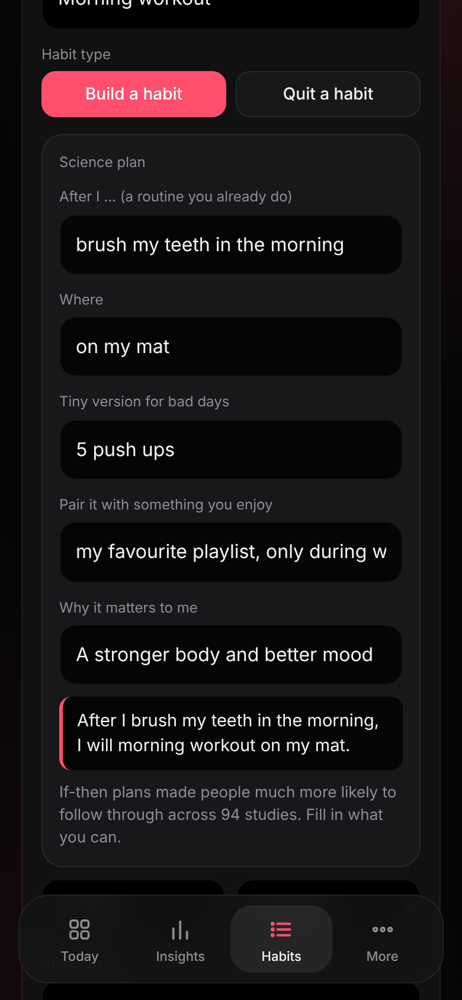
  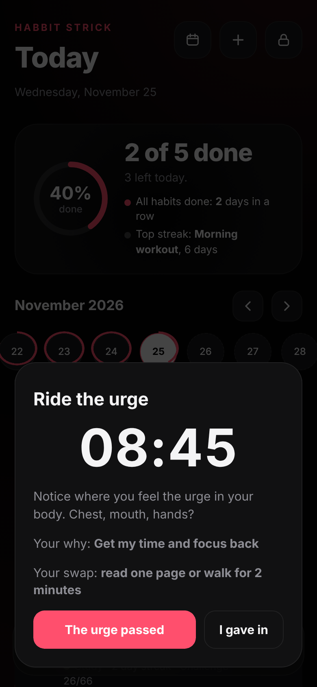
  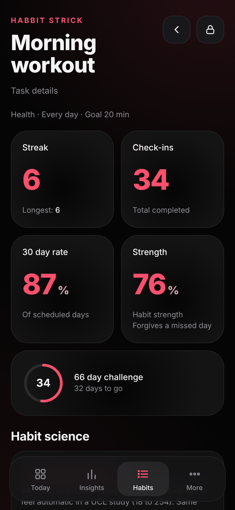
  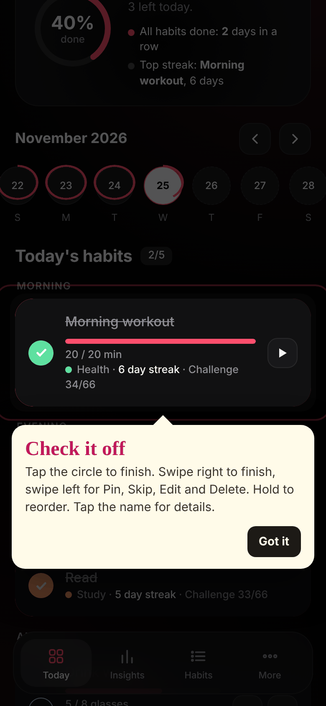
</p>

## Themes

Each theme changes the fonts, shapes, layout and colours of the whole app, not just the colour.

| Midnight | Paper | Arcade | Zen | Ocean |
|:---:|:---:|:---:|:---:|:---:|
| 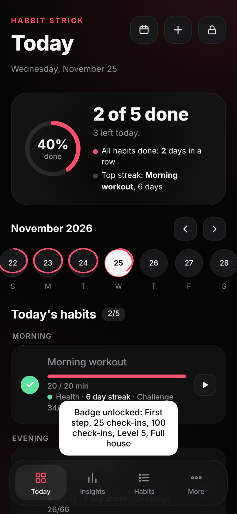 | 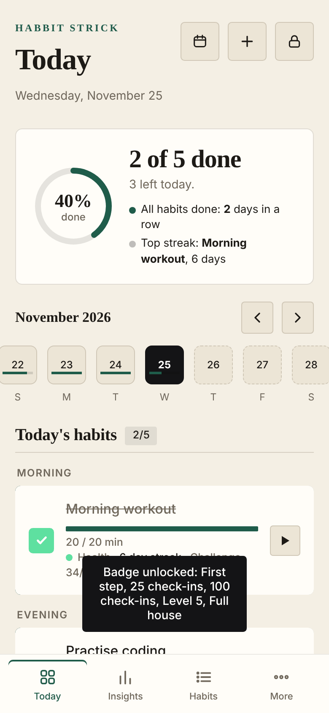 | 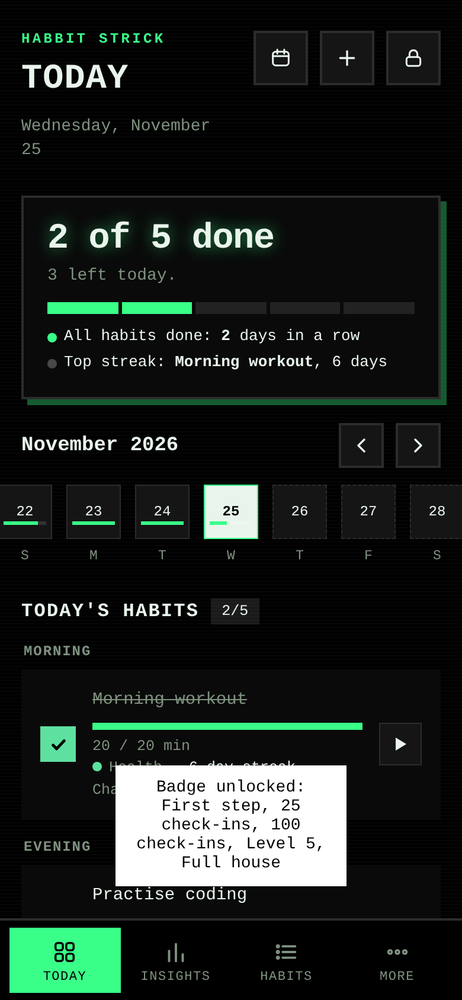 | 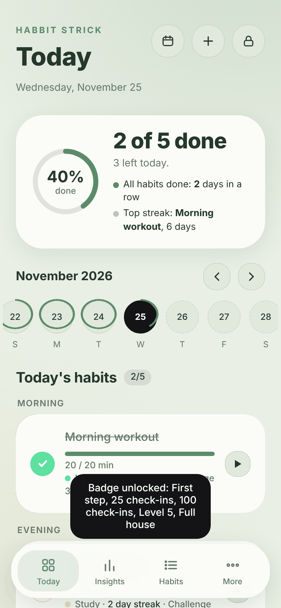 | 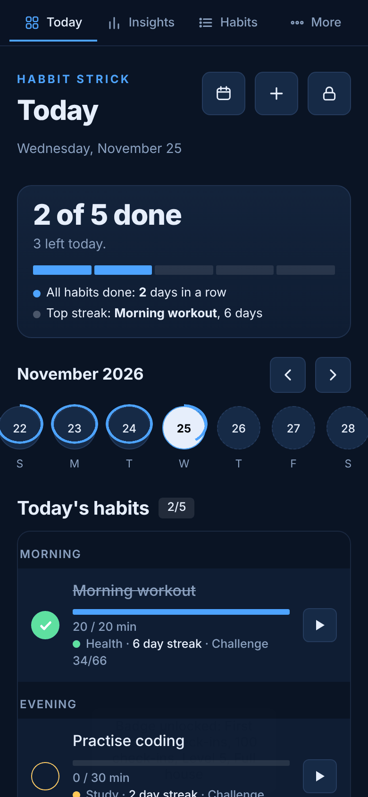 |
| Dark glass cards, bold type | Printed planner, serif type | Terminal style, monospace | Calm, rounded, roomy | Compact, tabs on top |

## The science behind it

Every tool in the app is based on published research. The in-app **Habit science** page explains each one.

| Method | Research | Where it is in the app |
|---|---|---|
| Habits take about 66 days on average (18 to 254) | Lally et al., 2010 | 66-day challenge, repetitions bar |
| Missing one day does not ruin a habit | Lally et al., 2010 | Habit strength, "never miss twice" |
| If-then plans (implementation intentions) | Gollwitzer and Sheeran, 2006 (94 studies) | Plan sentence on every habit |
| Stacking on an existing routine | Wood and Neal, 2007 | "After I..." cue |
| Pairing with something you enjoy | Milkman et al., 2014 | "Pair it with" field |
| Recording progress | Harkin et al., 2016 (138 studies) | Check-ins, heatmap, reports |
| Awareness and a competing response | Azrin and Nunn, 1973 | Trigger log, "Instead I will" |
| Urge surfing | Bowen and Marlatt, 2009 | Ride the urge timer |
| Abstinence violation effect | Marlatt and Gordon, 1985 | Slip support after "Broke it" |

## Install

**Android (8.0 or newer)**
1. Download [Habbit-Strick.apk](https://github.com/mrs1ddharthyadav/habbitstrick/releases/download/latest/Habbit-Strick.apk).
2. Open it and allow installs from your browser or file manager when Android asks.
3. Later updates are offered inside the app.

**Windows 10 or 11 (64-bit)**
1. Download [Habbit-Strick-Setup.exe](https://github.com/mrs1ddharthyadav/habbitstrick/releases/download/latest/Habbit-Strick-Setup.exe) and run it.
2. Windows SmartScreen may warn about an unknown publisher because the installer is not code-signed. Choose **More info**, then **Run anyway**.
3. The app updates itself in the background.

## Privacy and security

- All habit data is stored on your device, encrypted with **AES-256-GCM**. The key is derived from your password with **PBKDF2-SHA256** (200,000 iterations).
- Your password is never stored or sent anywhere. If you forget it, the data cannot be recovered, so keep a backup.
- Sync is optional. When it is on, only the encrypted vault is uploaded, so the server cannot read your habits.
- The app locks itself after a minute in the background. Fingerprint unlock is available on supported phones.
- There are no ads, no analytics and no trackers.

## Android permissions

| Permission | Why it is needed |
|---|---|
| Notifications, exact alarms, run at startup | Reminders that arrive on time, even after a restart |
| Vibrate | Haptic feedback and reminder alerts |
| Biometric | Optional fingerprint unlock |
| Internet | Optional sync and update checks |
| Install packages | Installing in-app updates |
| Display over other apps | Phone quiet lock screen (only when you turn it on) |
| Usage access | Phone quiet screen time and app blocking (only when you turn it on) |
| Foreground service | Keeps Phone quiet running while it is on |
| Accessibility service (optional) | A stronger Phone quiet lock that cannot be swiped away. It does not read your screen. |

## Build from source

The whole user interface is a single HTML file, `app/src/main/assets/index.html`. The Android app and the Windows app both wrap this same file, so every change reaches both platforms.

**Android** (JDK 17, Android SDK 34)
```bash
gradle assembleDebug
# output: app/build/outputs/apk/debug/app-debug.apk
```

**Windows** (Node.js 20)
```bash
cd desktop
mkdir app && cp ../app/src/main/assets/index.html app/index.html
npm install
npm start          # run in development
npm run dist       # build the installer into desktop/dist
```

**Web**

Open `app/src/main/assets/index.html` in any modern browser.

## Project structure

```
app/src/main/
  assets/index.html          The full app: UI, logic, encryption, sync
  java/com/habbitstrick/app/
    MainActivity.java        WebView host and the JavaScript bridge
    Reminders.java           Alarm scheduling and notifications
    ReminderReceiver.java    Done and Snooze actions
    BootReceiver.java        Restores reminders after a restart
    HabitWidget.java         Home screen widget
    Quiet.java               Phone quiet settings and screen time maths
    QuietService.java        Screen time counter, lock screen, app blocking
    LockAccess.java          Optional accessibility lock
    Updater.java             In-app updates
desktop/
  main.js                    Electron main process: tray, reminders, auto update
  preload.js                 Safe bridge between the app and Windows
.github/workflows/build.yml  Builds Android and Windows and publishes the release
docs/screenshots/            Images used in this README
```

## How releases work

Every push to `main` runs one GitHub Actions workflow:

1. **android** builds the APK and writes `version.json`.
2. **windows** builds the NSIS installer and `latest.yml` from the same commit.
3. **release** waits for both builds, then replaces the `latest` release with all files at once.

Android and Windows therefore always ship the same version, built from the same code. The Android app checks `version.json` when it opens. The Windows app checks `latest.yml` every hour and installs the update in the background.

---

<p align="center">Made by Sangam Yadav</p>
